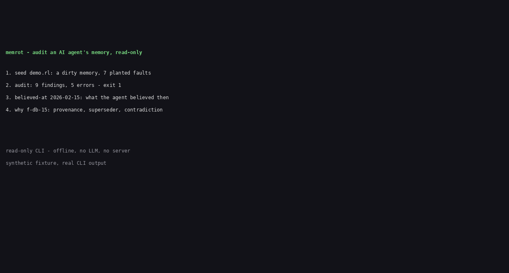

# memrot

Audit an AI agent's memory, read-only. One command opens a Relate `.rl` store and reports what the memory got wrong: contradictions, superseded facts still served, stale facts, orphaned entities, provenance-less facts, validity-order violations, and lexical near-duplicates. Exit 1 when the memory is rotten, exit 0 when it is clean.

For teams who run agents with persistent memory and want to know, before the next bad decision, whether the store the agent trusts still tells the truth.



## Why this exists

Agents remember by writing facts into a store and reading them back later. Nothing in that loop checks the store itself. Over weeks of sessions the memory rots: a limit changes and both values stay current, an upgrade supersedes a fact that is never marked superseded, a TTL expires and nobody notices, a fact arrives with no record of where it came from. The agent then acts on stale or contradictory memory with full confidence, and the failure looks like a reasoning bug when it is really a data bug.

The memory layers that exist today store memory; none of them audit it from the outside:

- **Graphiti** keeps bi-temporal facts and invalidates them at ingest, but the invalidation is an LLM judgement made silently during ingestion, behind a server. There is no standalone report, no CLI, no CI exit code.
- **Mem0** ingests ADD-only: one LLM pass extracts facts, with no UPDATE or DELETE on write and no second pass to reconcile what is already there. Contradictory and stale memories accumulate in long-running deployments, and the graph features are a paid tier. Nothing audits a Mem0 store from outside.
- **Cognee** and **Letta** have no first-class contradiction detection and no audit CLI.

memrot is the audit layer those tools do not have: open the store read-only, ask what is wrong in it, get a machine-checkable answer. It uses Relate (Neo4j's embedded graph database for AI agents) as the store, and every check is a Cypher query or a vector search executed inside Relate, not application-side logic.

## Install

memrot is not on npm yet (the name is free; v0.1.0 installs from source). Node 20+ required. The only runtime dependency is `@relate/relate` 1.0.1, pinned exact.

```sh
git clone https://github.com/techdevfun/memrot.git
cd memrot
npm install
npm run build
```

Clean install from source, measured 13 November 2026: `npm install + npm run build` took about 8 s (no cache).

Then run it from the repo root, or link it: `npm link` makes `memrot` available everywhere.

## Usage

```sh
memrot seed demo.rl
memrot audit demo.rl
memrot audit demo.rl --format json
memrot audit demo.rl --as-of 2026-03-01 --stale-days 30
memrot believed-at demo.rl --at 2026-02-15
memrot believed-at demo.rl --at 2026-02-15 --subject database
memrot why demo.rl f-db-15
```

Exit codes: `0` = clean (or command done), `1` = the audit found error-severity findings, `2` = usage error or store error (missing, locked, unreadable). Warnings alone do not fail the audit.

### Worked example (real output, seeded fixture)

`examples/demo.rl` is a seeded agent memory about a fictional migration, with 7 planted faults and 3 clean controls. Its faults are listed in `examples/seed.cypher` and asserted by the test suite.

```sh
$ memrot audit examples/demo.rl --as-of 2026-11-13

memrot audit: examples/demo.rl (as of 2026-11-13)

- Contradictory facts: 2 finding(s) [error]
  ERROR  database.engine has two current values in overlapping windows: "Postgres 15" (f-db-15) and "Postgres 16" (f-db-16).
  ERROR  queue.max_payload has two current values in overlapping windows: "4000 bytes" (f-queue-4000) and "8000 bytes" (f-queue-8000).
- Superseded facts still served: 1 finding(s) [error]
  ERROR  database.engine = "Postgres 15" (f-db-15) was superseded by f-db-16 but is still marked current, so it can still be served.
- Stale facts: 2 finding(s) [warning]
  WARN  cache.ttl = "300s" (f-cache-ttl) expired on 2026-06-01 and is still current. It is also old (recorded 2026-01-05T10:00:00Z) with no corroboration and no newer fact on the same subject and predicate.
  WARN  feature.flag = "on" (f-feature-flag) expired on 2026-04-01 and is still current. It is also old (recorded 2026-05-02T09:30:00Z) with no corroboration and no newer fact on the same subject and predicate.
- Orphaned entities: 1 finding(s) [warning]
  WARN  Entity "LegacyCron" (e-legacycron, kind service) has no relationships: nothing references it and it references nothing.
- Provenance-less facts: 1 finding(s) [error]
  ERROR  deploy.region = "eu-west-1" (f-deploy-region) has no episode: there is no record of where this fact came from.
- Validity-order violations: 1 finding(s) [error]
  ERROR  feature.flag = "on" (f-feature-flag) has validFrom 2026-05-01 after validTo 2026-04-01: the validity window is empty.
- Near-duplicate facts (lexical): 1 finding(s) [warning]
  WARN  database.engine = "Postgres 16" (f-db-16) and database.db_engine = "PostgreSQL 16" (f-db-16b) are near-duplicates (lexical cosine 0.93): the same claim recorded twice under different wording.

9 finding(s): 5 error(s), 4 warning(s)
audit: FAILED (exit 1)
```

Time travel, same store:

```sh
$ memrot believed-at examples/demo.rl --at 2026-02-15

  cache.ttl = "300s" (f-cache-ttl)
  database.db_engine = "PostgreSQL 16" (f-db-16b)
  database.engine = "Postgres 15" (f-db-15)
  database.engine = "Postgres 16" (f-db-16)
  queue.max_payload = "8000 bytes" (f-queue-8000)

5 fact(s) believed at 2026-02-15.
```

In February the agent already believed both Postgres 15 and Postgres 16. The contradiction was there from the start; the March payload change is not believed yet.

```sh
$ memrot why examples/demo.rl f-db-15

  database.engine = "Postgres 15"
  status current, valid 2026-01-01 to open, recorded 2026-02-01T08:30:00Z

  provenance: session 2026-02-01T08:00Z at 2026-02-01T08:30:00Z
    "DB still on Postgres 15"
  supporters: none
  superseded by: f-db-16
  supersedes: none
  contradicts:
    f-db-16: "Postgres 16"
```

## The seven checks

| # | Check | Rule | Severity |
|---|---|---|---|
| 1 | Contradiction | Two `current` facts, same subject + predicate, different object, overlapping validity windows. | error |
| 2 | Superseded-but-served | A fact with an incoming `SUPERSEDES` edge from another `current` fact, still marked `current`. | error |
| 3 | Stale | A `current` fact whose `validTo` is before the audit date, or older than `--stale-days` (default 90) with no corroboration and no newer fact on the same subject + predicate. | warning |
| 4 | Orphaned entity | An `Entity` with no relationships at all. | warning |
| 5 | Provenance-less fact | A `Fact` with no `FROM_EPISODE` edge. | error |
| 6 | Validity-order violation | `validFrom` after `validTo`, or a `SUPERSEDES` edge where the superseding fact was created before the fact it supersedes. | error |
| 7 | Near-duplicate (lexical) | Two facts whose trigram embeddings score at or above the threshold (default 0.91 on Relate's scale). Pairs that are already contradictions are excluded: check 1 owns those. | warning |

## Data model

memrot audits a memory graph with this shape (the shape `memrot seed` writes):

- `(:Entity {id, name, kind})` - person, tool, project, setting.
- `(:Episode {id, source, at, text})` - one agent turn or event; `source` is where the fact came from.
- `(:Fact {id, subject, predicate, object, validFrom, validTo, createdAt, status})` - one believed fact. `validFrom` / `validTo` are ISO dates or `null` (open-ended). `status` is `current` or `superseded`.
- `(f:Fact)-[:ABOUT]->(e:Entity)`, `(f:Fact)-[:FROM_EPISODE]->(ep:Episode)`, `(f:Fact)-[:SUPERSEDES]->(g:Fact)`, `(ep:Episode)-[:CONFIRMS]->(f:Fact)`.
- Each `Fact` carries an `embedding` property: a 64-dim unit-normalized character-trigram vector of `subject + predicate + object`, computed offline in-process with no model. It is lexical, not semantic.

Facts are nodes, not relationships, because the audit queries the facts themselves: supersession chains, validity windows, provenance edges, and a vector index on a property.

## Stores and locks (read this before auditing a live agent)

memrot opens the store read-only and never writes to it. But Relate has a lock rule you must know (verified live against `@relate/relate` 1.0.1):

- A `.rl` file held by a running writer **cannot** be opened read-only, and `relate clone` **cannot** copy it either. Both fail. memrot catches the failure and prints the remedy instead of the raw error.
- A **directory** store **can** be opened read-only beside a live writer. If you want to audit a running agent, use a directory store.
- For a `.rl` file: stop the agent first, then audit; or, after the writer exits, snapshot it (`relate clone store.rl snapshot.rl`) and audit the snapshot.

## Telemetry

The `relate` CLI ships with telemetry **enabled by default** (`relate telemetry status` returns `enabled (default)`). memrot itself sends nothing: its CI installs only the `@relate/relate` npm library, never the CLI. If you install the relate CLI, turn telemetry off first: `relate telemetry off`.

## Where rivals beat us

- **Graphiti's per-fact LLM judgement is more accurate per fact.** An LLM can tell that two differently-worded statements contradict each other; memrot's deterministic checks cannot. If you need semantic contradiction detection, Graphiti is the better tool for that job, and memrot is the audit you run after it.
- **Mem0 retrieval is more token-efficient.** A Mem0 retrieval stays under ~7,000 tokens with no LLM call; memrot is not a retrieval layer at all and does not try to be.
- **Relate itself is experimental** (Neo4j Labs, 1.0.1 at build time, moving fast). Pin the version; re-check before upgrading.

## What memrot does NOT do

- **No semantic paraphrase detection.** Deterministic structural checks catch same-predicate conflicts and lexical near-duplicates. They do not catch a contradiction phrased two different ways ("the queue is Postgres" vs "we moved off Postgres last week"). That is an explicit v1 limit, not a hidden one.
- **No writes, no fixes.** memrot reports; it never edits the store. Fixing a finding is a human (or agent) decision with its own audit trail.
- **No embedder, no LLM, no network.** The audit runs fully offline. That is the point: an audit that needs a model call cannot run in CI on every commit.

## Roadmap

- v1.1: optional embedder-backed vectors for semantic near-duplicates (bring your own embedding model; the trigram check stays the offline default).
- v1.1: `memrot index <store>` - build the vector index and embeddings on a copy of a store, so check 7 runs on stores that were not seeded by memrot.
- v1.1: `--fail-on warning` flag for stricter CI gates.

## Why a single-file `.rl` store

The submission this tool is built for (Relate by Neo4j Hackathon, theme "Context, Connected") asks for a persistent Relate store. A single `.rl` file is the whole point: a memory an agent carries as one file, auditable anywhere, no server to deploy. Directory mode exists for live auditing beside a writer; `:memory:` mode exists for tests. The README answers the hackathon's how/why: memrot uses Relate as its only store, in single-file mode, with Cypher traversals plus vector search doing all the audit work.

## Contributing

See [CONTRIBUTING.md](CONTRIBUTING.md). Tests: `npm test` (15 tests, all against seeded stores with known ground truth). Preflight (ASCII-only public content): `node scripts/preflight.js`.

## License

MIT. Relate is Apache 2.0 (Neo4j Labs); memrot's own code is MIT.
